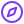
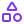
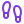

<!-- readme-standard: 2026-11-02 -->
<div align="center">



# 🎨 PIR® Brand Assets

*The official home of PIR®'s logos, marks and brand guidance.*

[](https://www.psychedelicsinrecovery.org)
[](BRAND-GUIDELINES.md)
[](#roadmap)


 **You are here:** PIR® › `brand-assets` · public · `main` is the working branch

</div>

##  TL;DR

1.  **What this is.** PIR®'s logos, marks and brand guidance. For now, placeholders collected from older sources; they aren't final masters.
2.  **Who it is for.** Anyone who needs a logo for a flyer, a slide, a podcast cover, merch or a press mention.
3.  **Do this first.** Read [`BRAND-GUIDELINES.md`](BRAND-GUIDELINES.md) before using the marks.

**The official home of PIR®'s logos, marks and brand guidance.** If you need a PIR logo for a
flyer, a slide, a podcast cover, merch or a press mention, get it here, not from the WordPress
media library or someone's personal drive.


> **PIR®** and **Psychedelics In Recovery™** are marks of Psychedelics In Recovery, a 501(c)(3)
> nonprofit. Please read [`BRAND-GUIDELINES.md`](BRAND-GUIDELINES.md) before using them.

---

## 📁 What's here

```
brand-assets/
├── README.md              ← you are here
├── BRAND-GUIDELINES.md    ← how to use (and not use) the marks
└── legacy/                ← placeholder files collected so far (see below)
```

Planned layout as real assets arrive:

```
logos/
  stacked/      icon above the "PIR" lettering
  wordmark/     "PSYCHEDELICS in RECOVERY" lettering
  icon/         the eye-in-diamond mark on its own
vectors/        .svg / .pdf / .ai / .eps master files
raster/         .png (transparent) and .jpg exports at standard sizes
```

## 🗂️ Legacy placeholders (`legacy/`)

These were gathered from older sources so nothing gets lost. They aren't final masters.

| File | What it is (verified ✅ / to check ⏳) |
|---|---|
| `PIR_B.png` | ✅ Stacked logo: eye-in-diamond icon over **PIR**, navy on white |
| `1000083345.png` | ✅ Stacked logo, **white** version (for dark backgrounds) |
| `1000083353.png` | ✅ Full wordmark: icon over **PSYCHEDELICS in RECOVERY**, navy |
| `PIR_A.png` | ⏳ Appears white or transparent; likely a white stacked logo |
| `PIR_A.jpg`, `PIR_B.jpg`, `PIR_C.*`, `PIR_D.*` | ⏳ Variants to catalog |
| `1000083346.png`, `1000083349–1000083352.jpg` | ⏳ Variants to catalog |

**Brand navy:** approximately `#212A5A` (sampled from the legacy PNGs; confirm against a master
file).

<a id="roadmap"></a>
## 🛣️ Roadmap

- [ ] Catalog and descriptively rename every legacy file (e.g. `pir-stacked-navy.png`).
- [ ] **Vectorize** the marks into clean SVGs (Anne's project), then export standard PNG sizes.
- [ ] Add the ® / ™ versions of each mark.
- [ ] Confirm official colors (HEX / RGB / CMYK) and typography.
- [ ] Add social-media kit sizes (avatars, banners) for TikTok, Instagram, YouTube, LinkedIn,
      Facebook, Spotify/Buzzsprout and Discord.

## 🙋 Requesting or contributing assets

- **Need something that isn't here?** Email **pr@psychedelicsinrecovery.org**, or open a TechCom
  ticket once the PIR helpdesks are live.
- **Have an original or vector file?** Send it to the PR committee. Please don't edit the marks
  yourself; see the guidelines.


##  Suggest a change

Noticed something? Open an [issue](https://github.com/psychedelicsinrecovery/brand-assets/issues) or a pull request against `main`; the PR Committee reads them and a person with the role merges. Not on GitHub? Type `/pr` in [PIR®'s Discord](https://discord.gg/MyprTq8w95).

## 📄 License
- 📚 **Everything here is all rights reserved**, see [`LICENSE`](LICENSE). Please ask before reproducing or redistributing.
- 🏷️ **Names, logos and marks:** see [`TRADEMARKS.md`](TRADEMARKS.md)

---

*Part of PIR's move to make GitHub the canonical source for PIR media. Literature lives in
[`psychedelicsinrecovery/publications`](https://github.com/psychedelicsinrecovery/publications).*

<sub>The front door follows the living [README standard](https://github.com/drasticstatic/my-template/blob/main/README-STANDARD.md). Copy it, improve it.</sub>
